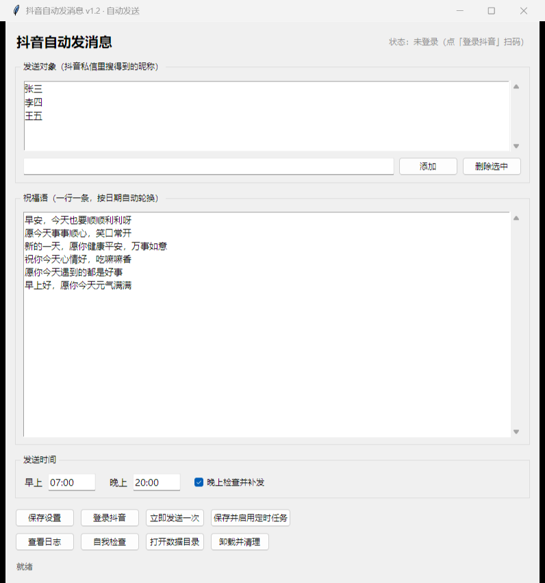

# 抖音自动发消息

> 用 Windows 自带的 Edge 打开抖音网页版，每天定时给指定好友发一条祝福语。
> 单文件程序、带图形界面、零运行库依赖、带一键卸载。



## 它做什么

到点自动打开抖音网页版 → 点「消息」→ 搜索指定好友 → 进入会话 → 发送一条祝福语 → 关闭浏览器。

- **不用装 Python / 浏览器内核**：只依赖系统自带的 Microsoft Edge
- **本机运行**：没有服务器、没有账号池、没有遥测，代码里只访问 ` douyin.com` 一个域名
- **发送对象、祝福语、时间都能改**，改完点保存即可
- **登录一次**（扫码），之后自动保持
- **晚上会检查**：早上没发成功的，晚上补发；成功过的不重复发
- **运行期间系统静音**，结束后恢复原音量

## 快速开始（Windows 10 / 11）

1. 到 [Releases](../../releases) 下载 `DouyinAutoMessage_v*.zip` 并解压
2. 双击 `DouyinAutoMessage.exe`
3. 点「登录抖音」，用抖音 App 扫码（只需一次）
4. 在「发送对象」里添加好友昵称（能搜到他即可，emoji 等符号可以省略）
5. 在「祝福语」里写内容，一行一条，会按日期轮换
6. 点「立即发送一次」确认能收到
7. 点「保存并启用定时任务」——会先弹出风险清单，勾选确认后才启用

> **首次运行被 Windows 拦截？** 程序没有买数字签名证书，Defender / SmartScreen 会对
> 「未签名 + 创建计划任务」的组合报警（实测误报 `Behavior:Win32/Execution.A!ml`）。
> 按解压出来的 `使用说明.txt` / `放行说明.txt` 里的两步操作即可。

## 从源码运行

```bat
uv venv --python 3.12
uv pip install -r requirements.txt
.venv\Scripts\python.exe app.py
```

命令行模式（调试用）：

```bat
.venv\Scripts\python.exe core.py --preview        :: 看今天每个人会收到哪句
.venv\Scripts\python.exe core.py --login          :: 打开浏览器登录
.venv\Scripts\python.exe app.py --run morning     :: 手动跑一次
```

## 自己打包 exe

```bat
build.cmd
```

产物在 `dist\DouyinAutoMessage\`（约 147 MB，可整体压缩分发）。

## 工作原理

| 环节 | 做法 |
|---|---|
| 浏览器 | Playwright 驱动系统 Edge；CDP 走 `--remote-debugging-pipe`，**不开 TCP 调试端口** |
| 定位控件 | 按可见文字找元素（「消息」「发消息」），不依赖写死的坐标 |
| 输入 | CDP `insertText`，中文正常；发送后校验「输入框已清空 + 消息出现在页面里」 |
| 定时 | `schtasks` 注册两个计划任务，使用当前用户令牌、最低权限（`LeastPrivilege`） |
| 静音 | Windows Core Audio（pycaw），记录原状态，结束恢复 |
| 卸载 | 删任务 + 删数据目录；勾选后才删程序文件夹（用一次性 .bat 延迟自删） |

## 数据目录

```
%LOCALAPPDATA%\DouyinAutoMessage
  config.json     配置（对象、祝福语、时间）
  state.json      发送记录（当天已发的人）
  profile\        浏览器登录状态（含 cookie，**不要外传**）
  logs\           每天的运行日志
  shots\          失败时的截图
  crash.log       启动失败时的记录
```

程序不写注册表、不装服务、不改系统设置。

## 常见问题

**Q：为什么第一次运行会被杀毒软件拦？**
A：程序未签名，且会创建计划任务——这是启发式/行为检测最容易命中的组合。可在
[此处](https://www.microsoft.com/en-us/wdsi/filesubmission) 提交误报，或按 `放行说明.txt` 手动放行。

**Q：会封号吗？**
A：只发送低频、少量、固定的私信，属于个人自用；但自动化操作本身存在被平台限制的可能，请用不重要的账号先试。

**Q：网页改版了怎么办？**
A：日志会写明失败在哪一步（「消息抽屉没打开」/「搜索结果里没有」），按新界面改
`core.py` 里的文字定位即可，通常几行。

**Q：能发群消息吗？**
A：可以，搜索结果里第一条是群聊就会进群聊。注意别发错对象，日志会记录命中行。

## 免责声明

本项目仅供个人学习与自用。使用自动化脚本操作抖音可能违反其用户协议，存在账号被限制或封禁的风险，
请自行评估并承担。**请勿用于营销、群发、骚扰他人等用途。**

## 反馈

请到 [Issues](../../issues) 提问，附上：

- 程序版本（标题栏里的 v1.2）
- 程序里「查看日志」→「复制全部」的内容
- 你点了哪一步、期望发生什么

## 许可

MIT，见 [LICENSE](LICENSE)。

打包产物内含第三方组件：CPython（PSF License）、Tcl/Tk（BSD 风格）、
Playwright（Apache-2.0）、pycaw/comtypes（MIT/BSD）、PyInstaller（GPL with exception，打包不影响本项目的 MIT 许可）。
